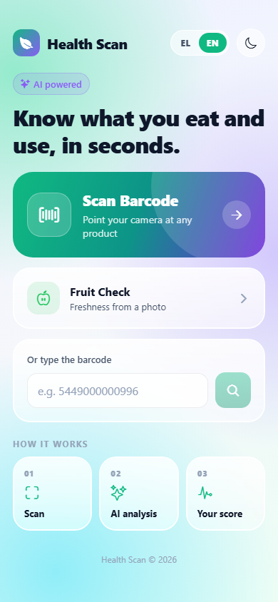
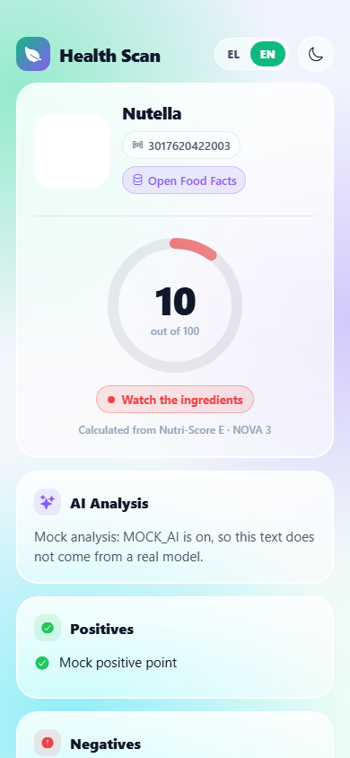
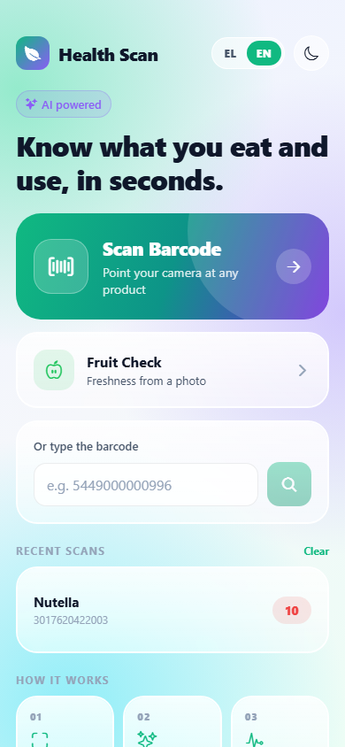
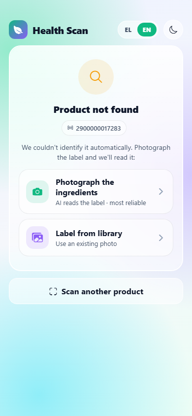
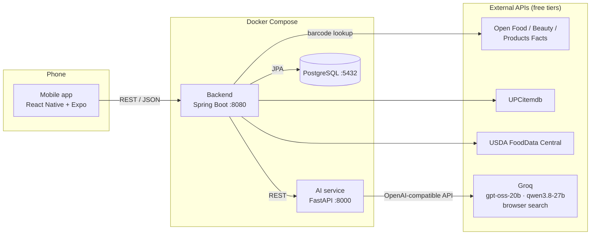
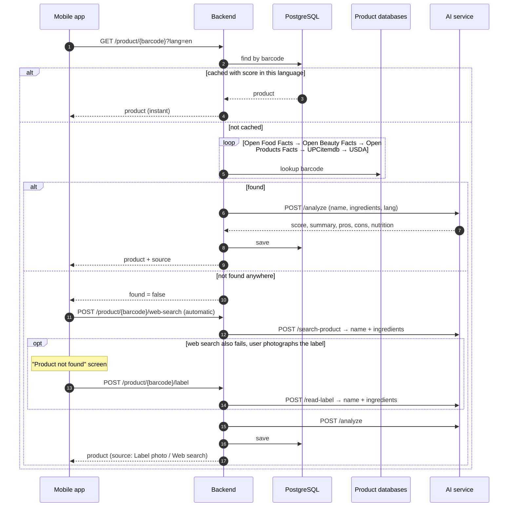
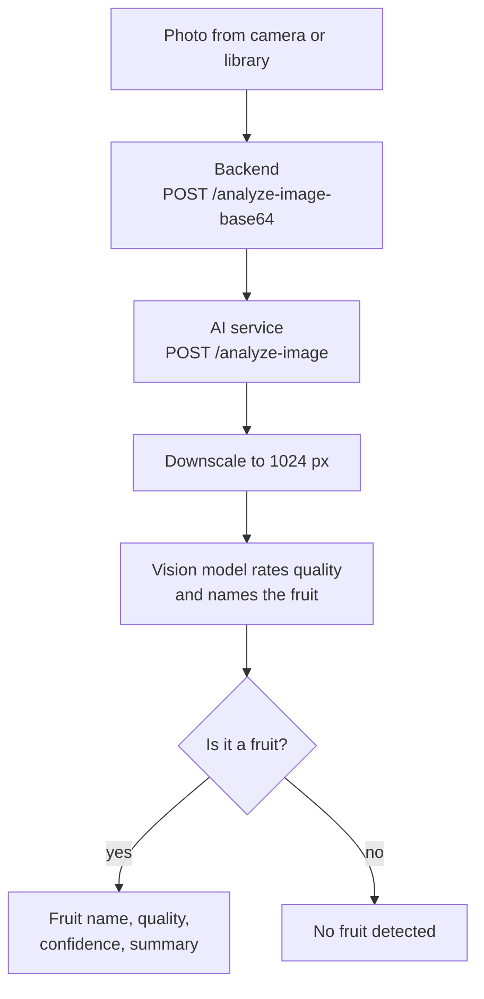
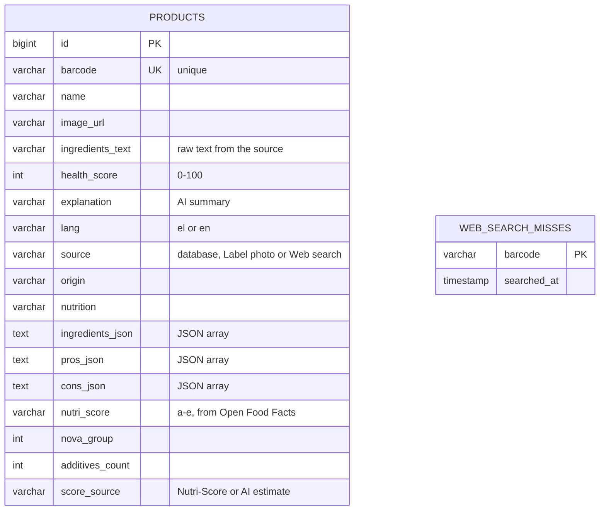
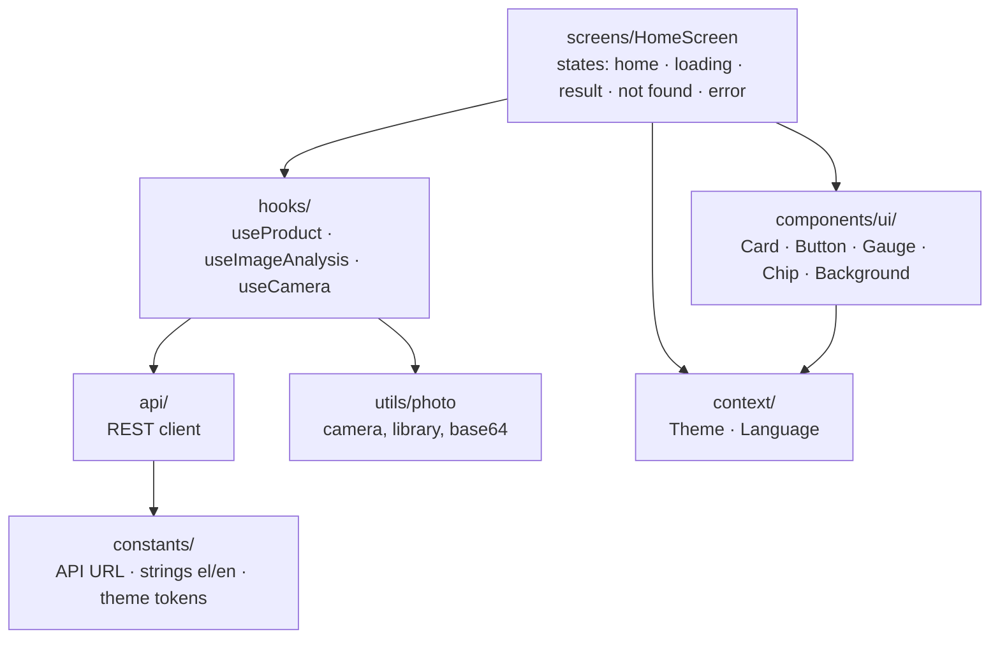
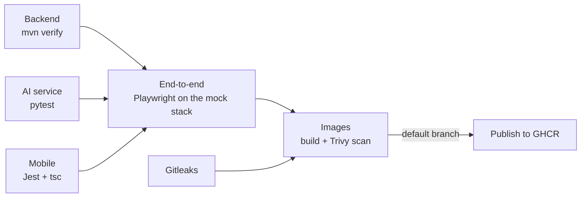

# Health Scan


**Know what you eat and use, in seconds.**

Health Scan is a mobile app that scans product barcodes and fruit photos and tells you how healthy they are. Scan food, cosmetics and other everyday products to get a 0–100 health score with positives, negatives, ingredients and nutrition facts, or take a photo of a fruit to check whether it is fresh or spoiled.

## Screenshots

| Home | Product | Recent scans | Not found |
|------|---------|--------------|-----------|
|  |  |  |  |

Taken automatically by the Playwright end-to-end tests on the web version, with `MOCK_AI=1`, so the analysis texts are placeholders rather than real model output.

## Table of contents

- [Screenshots](#screenshots)
- [Features](#features)
- [How the score works](#how-the-score-works)
- [Architecture](#architecture)
  - [System overview](#system-overview)
  - [Components](#components)
  - [Barcode scan flow](#barcode-scan-flow)
  - [Fruit check flow](#fruit-check-flow)
  - [Data model and caching](#data-model-and-caching)
  - [Mobile app structure](#mobile-app-structure)
  - [Design decisions](#design-decisions)
- [Data sources](#data-sources)
- [Getting started](#getting-started)
- [Configuration](#configuration)
- [API reference](#api-reference)
- [Project structure](#project-structure)
- [Security](#security)
- [Testing](#testing)
- [Troubleshooting](#troubleshooting)
- [Roadmap](#roadmap)
- [Acknowledgements](#acknowledgements)
- [License](#license)

## Features

- **Barcode scanning** – reads every common format: EAN/UPC, ITF-14, Code 128/39/93, and the square codes on newer packs (GS1 DataMatrix and GS1 Digital Link QR), from which it takes the product's barcode number. It looks the product up in five free databases and gives a 0–100 health score, calculated from Nutri-Score, NOVA and additives when Open Food Facts has them; an LLM writes the summary, positives, negatives, ingredients and nutrition facts.
- **Unknown products** – if no database knows the barcode, the app searches the web automatically, and the user can photograph the ingredient label (read by a vision model) if that fails too. The result is saved, so the next scan is instant.
- **Fruit quality check** – a vision model identifies any fruit in a photo and rates it as fresh, spoiled or uncertain. If the photo isn't a fruit, the app says what it shows instead.
- **Recent scans** – the last 20 products stay on the device; tap one to open it again.
- **Caching** – every analyzed product is stored in PostgreSQL, so a repeat scan is instant.
- **Web version** – the same app runs in a browser (`npm run web`).
- **Greek and English**, light and dark theme, glassmorphism UI.
- **Free to run** – every external service used has a free tier, and `MOCK_AI=1` runs everything without a Groq key.

## How the score works

When Open Food Facts has a Nutri-Score grade for the product, the score is calculated, so the same product always gets the same number:

| Input | Effect |
|-------|--------|
| Nutri-Score grade | Starting point: A 90, B 72, C 55, D 35, E 15 |
| NOVA group | NOVA 4 (ultra-processed) −10, NOVA 3 (processed) −5 |
| Additives | −2 each, at most −10 |

The result is kept between 0 and 100. The LLM receives the score and these facts and only writes the explanation; if it returns another number, the calculated one is used. Products without a Nutri-Score (cosmetics, label photos, web search results, most non-European foods) get an AI estimate instead, and the app labels which one it is. The app also shows that scores are guidance, not medical advice.

## Architecture

### System overview



The phone talks only to the backend. The backend owns the database and the product lookup, and delegates all machine learning to the AI service, which is the only component holding the Groq API key.

### Components

| Component | Stack | Responsibility |
|-----------|-------|----------------|
| **Mobile app** (`mobile/`) | React Native 0.88, Expo SDK 58, TypeScript | Barcode scanner, photo capture, results UI, language and theme |
| **Backend** (`backend/`) | Java 17, Spring Boot 3.3, Spring Data JPA, Flyway, WebClient | REST API, product lookup chain, caching, orchestration of AI calls |
| **AI service** (`ai-service/`) | Python 3.11, FastAPI, OpenAI SDK → Groq | Health scoring, label reading, web search, fruit quality |
| **Database** | PostgreSQL 16, schema managed by Flyway | Cache of analyzed products |
| **HTTPS proxy** (`caddy/`, optional) | Caddy 2 | TLS with automatic certificates, HTTP to HTTPS redirect, security headers |

**Models**

| Task | Model | Where it runs |
|------|-------|---------------|
| Health score, summary, pros/cons | `openai/gpt-oss-20b` (low reasoning effort, JSON mode) | Groq |
| Web search for unknown barcodes | `openai/gpt-oss-20b` + built-in browser search | Groq |
| Label reading, fruit identification and quality | `qwen/qwen3.8-27b` (vision) | Groq |

### Barcode scan flow



### Fruit check flow



### Data model and caching



Caching rules:

- A product is served from the cache only if it has a score **and** was analyzed in the requested language; otherwise it is looked up and analyzed again.
- Barcodes that no source knows are **not** cached in `products`, so a later scan, label photo or web search can still fill them in.
- A failed web search is recorded in `web_search_misses` and not repeated for a day, which protects the Groq quota. AI outages are not recorded.
- Label photo and web search products are in no database, so a request in the other language re-analyzes them from the cached row.
- Concurrent scans of the same new barcode are safe: a duplicate insert is ignored and every request gets the analysis.
- Rows saved before scores were calculated (no `score_source`) are analyzed once more.
- The schema is managed by [Flyway](https://flywaydb.org) migrations in `backend/src/main/resources/db/migration`; Hibernate only validates that the entities match it. A database created before Flyway (by Hibernate's old `ddl-auto=update`) is baselined and upgraded automatically on the next start, with its rows kept.

### Mobile app structure



- **Screens** render state; **hooks** own the state and side effects; **api** only does HTTP.
- **components/ui** is a small design system: frosted glass cards (`expo-blur`), gradient buttons, an SVG score ring and chips, all driven by theme tokens.
- All user-facing text lives in `constants/strings.ts` in Greek and English.

### Design decisions

- **Separate AI service.** Python suits ML and image work, while Java/Spring handles the API and persistence. Each side can be scaled or replaced independently, and only the AI service holds the Groq key.
- **One scoring path.** Label photos and web search only *identify* the product (name and ingredients); scoring always goes through the same `/analyze` endpoint, so results are consistent regardless of source.
- **Lookup chain, cheapest first.** Free open databases come first, rate-limited APIs next, then an automatic web search the user can skip. The app starts the search after the lookup returns, so the first response stays fast.
- **Vision model only for fruit.** An earlier version ran YOLOv8 first, but it only knew three fruits and saved no LLM calls, so it was removed. The user's square crop already centres the fruit.
- **Calculated score, AI text.** A formula over Open Food Facts data is reproducible and explainable; the LLM only explains it.
- **Base64 JSON uploads.** Photos are sent as base64 in JSON, which avoids multipart quirks in React Native; the image picker provides the base64 directly.

## Data sources

| Source | Covers | Key | Limit |
|--------|--------|-----|-------|
| [Open Food Facts](https://world.openfoodfacts.org) | Food, worldwide | None | Generous |
| [Open Beauty Facts](https://world.openbeautyfacts.org) | Cosmetics | None | Generous |
| [Open Products Facts](https://world.openproductsfacts.org) | Other products | None | Generous |
| [UPCitemdb](https://www.upcitemdb.com/api/explorer) | General retail, names only | None (trial) | 100 lookups/day |
| [USDA FoodData Central](https://fdc.nal.usda.gov/api-guide) | US branded foods | Free key (or `DEMO_KEY`) | Low with `DEMO_KEY` |
| [Groq](https://console.groq.com) | LLM, vision, web search | Free key | Free-tier rate limits |

## Getting started

### Prerequisites

- [Docker](https://docs.docker.com/get-docker/) with Docker Compose
- [Node.js](https://nodejs.org/) 22+
- A free [Groq API key](https://console.groq.com/keys)
- The [Expo Go](https://expo.dev/go) app on your phone

### 1. Configure

```bash
cp .env.example .env                # set GROQ_API_KEY, POSTGRES_PASSWORD and AI_SHARED_SECRET
cp mobile/.env.example mobile/.env  # set your computer's LAN IP
```

### 2. Start the backend services

```bash
docker compose up -d --build
```

This starts PostgreSQL, the AI service and the backend. The backend waits until the other two report healthy. Check that all three show `healthy`, then try a product:

```bash
docker compose ps
curl "http://localhost:8080/api/v1/product/3017620422003?lang=en"
```

Only the backend is published on the host. PostgreSQL and the AI service are reachable only inside the Compose network.

### 3. Start the mobile app

```bash
cd mobile && npm install && cd ..
npm start
```

Scan the QR code with your phone's camera (iOS) or the Expo Go app (Android). The phone must be on the same Wi-Fi network as your computer.

To run it in a browser instead, set `CORS_ALLOWED_ORIGINS=http://localhost:8081` in `.env`, restart the stack, and run `cd mobile && npm run web`.

### 4. Production with HTTPS (optional)

For a server that other people use, put the backend behind the Caddy proxy. Point a domain at the server, open ports 80 and 443, and add to `.env`:

```bash
DOMAIN=api.example.com              # Caddy gets and renews a Let's Encrypt certificate for it
BACKEND_BIND=127.0.0.1              # the plain-HTTP backend is no longer reachable from outside
FORWARD_HEADERS_STRATEGY=native     # the backend reads each client's address from the proxy
```

Then start everything with the proxy and point the app at the domain:

```bash
docker compose --profile https up -d --build
# mobile/.env: EXPO_PUBLIC_API_BASE=https://api.example.com
```

Plain HTTP requests are redirected to HTTPS. Without the `https` profile nothing changes, so local development over the LAN keeps working with plain HTTP. With `DOMAIN` left empty, Caddy serves `localhost` with a locally generated certificate that phones do not trust, which is only useful for testing.

## Configuration

| Variable | File | Required | Description |
|----------|------|----------|-------------|
| `GROQ_API_KEY` | `.env` | Yes | Groq API key for scoring, label reading, fruit quality and web search |
| `POSTGRES_PASSWORD` | `.env` | Yes | Database password. PostgreSQL reads it only when the `pgdata` volume is first created; an existing volume keeps its old password |
| `AI_SHARED_SECRET` | `.env` | Yes | Secret the backend sends to the AI service in `X-Internal-Secret`. Generate one with `openssl rand -hex 32` |
| `API_KEY` | `.env` | No | When set, the backend requires it in the `X-Api-Key` header. Empty disables the check |
| `USDA_API_KEY` | `.env` | No | USDA FoodData Central key; defaults to the rate-limited `DEMO_KEY` |
| `BACKEND_PORT` | `.env` | No | Host port for the backend; defaults to `8080` |
| `MOCK_AI` | `.env` | No | `1` makes the AI service answer with canned data, with no Groq key or network (demos, end-to-end tests) |
| `CORS_ALLOWED_ORIGINS` | `.env` | No | Comma-separated origins allowed to call the API from a browser, for the web version. Empty turns CORS off |
| `DOMAIN` | `.env` | With `--profile https` | Public domain for the HTTPS proxy; empty means `localhost` |
| `BACKEND_BIND` | `.env` | No | Address the backend port is published on; `127.0.0.1` behind the HTTPS proxy, `0.0.0.0` (default) for LAN development |
| `FORWARD_HEADERS_STRATEGY` | `.env` | No | `native` behind the HTTPS proxy, so rate limits see each client; `none` (default) otherwise |
| `HTTP_PORT`, `HTTPS_PORT` | `.env` | No | Host ports of the HTTPS proxy; default `80` and `443` |
| `EXPO_PUBLIC_API_BASE` | `mobile/.env` | Yes | Backend URL reachable from the phone, e.g. `http://192.168.1.10:8080` |
| `EXPO_PUBLIC_API_KEY` | `mobile/.env` | No | Must match `API_KEY`; the app sends it in `X-Api-Key` |

## Security

The backend is the only public entry point, so it carries the protections:

| Protection | Behaviour |
|------------|-----------|
| Input validation | Barcodes must be 8 to 14 digits and `lang` must be `el` or `en`; anything else is `400` |
| Upload limit | Image bodies over 8 MB are `413`; text that is not valid base64 is `400` |
| Rate limiting | Per client IP with Bucket4j: 10 requests a minute for the endpoints that call Groq (`/web-search`, `/label`, `/analyze-image*`) and 60 a minute for `GET /product`. Over the limit is `429` with a `Retry-After` header |
| API key | Optional `X-Api-Key` header, checked only when `API_KEY` is set; a missing or wrong key is `401` |
| Internal network | PostgreSQL and the AI service publish no ports, and the AI service rejects any request without the shared `X-Internal-Secret` (`401`), except `/health` |
| HTTPS | Optional Caddy proxy (`--profile https`): automatic certificates, HTTP to HTTPS redirect, HSTS, `nosniff`, `no-referrer`, no `Server` header, 9 MB body cap |
| Containers | The backend and the AI service run as an unprivileged user, not root |
| Database schema | Versioned Flyway migrations; Hibernate cannot change the schema (`ddl-auto=validate`) |
| Shared data | A label photo only fills in an unknown barcode; it cannot replace a product other users see |
| Errors | RFC 9457 problem JSON with a short message; no stack traces leave the server |
| AI replies | Validated with Pydantic before use; an unusable reply is `502`, and every Groq call has a timeout |
| CORS | Off unless `CORS_ALLOWED_ORIGINS` lists the web app's origin |
| Production profile | `SPRING_PROFILES_ACTIVE=prod` (set by docker-compose) turns off SQL logging and the API docs |

> **The API key is an abuse deterrent, not real authentication.** It is built into the app bundle, so anyone with the app can extract it. It stops casual scripts from spending your Groq quota; it does not identify users. Real authentication would need per-user accounts and tokens.

Rate limits are per client IP address. Behind the HTTPS proxy, `FORWARD_HEADERS_STRATEGY=native` makes the backend take the address from `X-Forwarded-For`, which Caddy always sets itself, so a client cannot fake its address to dodge the limit. Without the proxy, keep the setting off, or anyone who can reach the backend directly could send that header.

**Scanning in CI.** Every push and pull request runs [Gitleaks](https://github.com/gitleaks/gitleaks) for committed secrets, [CodeQL](https://codeql.github.com) for Java, Python and TypeScript, and [Trivy](https://trivy.dev) on both Docker images. Dependabot opens weekly update pull requests. Trivy reports but does not fail the build: some of the vulnerabilities it finds in the backend's dependencies are fixed only in Spring Framework 7, which needs the Spring Boot 4 migration on the roadmap.

## API reference

### Backend (`http://localhost:8080/api/v1`)

Errors use [RFC 9457](https://www.rfc-editor.org/rfc/rfc9457) problem JSON: `400` invalid barcode, language or image, `401` missing or wrong API key, `413` image over 8 MB, `429` rate limit (see `Retry-After`).

| Method | Path | Body | Description |
|--------|------|------|-------------|
| `GET` | `/product/{barcode}?lang=en\|el` | – | Look up and score a product. Returns `found: false` if no source knows it |
| `POST` | `/product/{barcode}/label?lang=` | `{"image": "<base64>"}` | Identify a product from a label photo |
| `POST` | `/product/{barcode}/web-search?lang=` | – | Search the web for the barcode (slow, ~10–30 s). The app calls this automatically; misses are remembered for a day |
| `POST` | `/analyze-image` | multipart `file` | Fruit identification and quality |
| `POST` | `/analyze-image-base64` | `{"image": "<base64>"}` | Fruit identification and quality |

<details>
<summary>Example product response</summary>

```json
{
  "barcode": "3017620422003",
  "name": "Nutella",
  "found": true,
  "source": "Open Food Facts",
  "healthScore": 15,
  "explanation": "High in sugar and palm oil, low nutritional value.",
  "origin": "Italy",
  "nutrition": "≈539 kcal, 31 g fat, 57 g carbs (56 g sugar), 5 g protein per 100 g",
  "ingredients": ["sugar", "palm oil", "hazelnuts", "cocoa", "skimmed milk powder"],
  "pros": ["Convenient spread", "Rich flavor"],
  "cons": ["Very high sugar content", "High in saturated fat"],
  "imageUrl": "https://images.openfoodfacts.org/..."
}
```

</details>

### AI service (internal, `http://ai-service:8000`)

Reachable only from the backend on the Compose network. Every endpoint except `/health` requires the `X-Internal-Secret` header.

| Method | Path | Description |
|--------|------|-------------|
| `POST` | `/analyze` | Health score, summary, pros/cons from name + ingredients |
| `POST` | `/analyze-image` | Fruit identification and quality |
| `POST` | `/read-label` | Extract product name and ingredients from a label photo |
| `POST` | `/search-product` | Find a product by barcode on the web |
| `GET` | `/health` | Health check |

Interactive docs are at `/docs` (FastAPI Swagger UI). To open them, run the AI service on its own with `uvicorn main:app` and no `AI_SHARED_SECRET`.

The backend's own docs are at `http://localhost:8080/swagger-ui.html` when it runs without the `prod` profile (for example with `mvn spring-boot:run`).

## Project structure

```
.
├── docker-compose.yml
├── .env.example
├── caddy/Caddyfile            # optional HTTPS proxy
├── ai-service/                # FastAPI + Groq
│   ├── main.py
│   ├── mock_ai.py             # canned answers for MOCK_AI=1
│   ├── tests/
│   ├── requirements.txt
│   └── Dockerfile
├── backend/                   # Spring Boot REST API
│   ├── pom.xml
│   ├── Dockerfile
│   └── src/main/java/com/healthscan/backend/
│       ├── config/            # settings, AI client, CORS
│       ├── controller/        # REST endpoints
│       ├── service/           # lookup chain, score formula, AI orchestration
│       ├── web/               # rate limit, API key, upload limit, error handling
│       ├── entity/            # JPA entity
│       ├── repository/        # Spring Data repository
│       ├── dto/               # request/response models
│       └── (resources) db/migration/  # Flyway migrations
├── e2e/                       # Playwright API and web tests
├── docs/screenshots/          # produced by the end-to-end tests
└── mobile/                    # Expo app
    ├── App.tsx
    ├── .env.example
    └── src/
        ├── api/               # backend client
        ├── components/ui/     # design system
        ├── constants/         # API URL, strings, theme
        ├── context/           # theme and language providers
        ├── hooks/             # useProduct, useImageAnalysis, useHistory, useCamera
        ├── screens/           # HomeScreen and its parts in screens/home
        └── utils/             # photo capture and encoding
```

## Testing

| Suite | Tests | Tools | What it covers |
|-------|-------|-------|----------------|
| Backend | 119 | JUnit 5, Mockito, MockMvc, Testcontainers | Cache rules, lookup chain, score formula, validation, rate limits, API key, CORS, real PostgreSQL, Flyway upgrades |
| AI service | 46 | pytest, a fake Groq client | Reply validation, prompts, image sizes, shared secret, mock mode |
| Mobile | 36 | Jest, React Native Testing Library | Product, fruit and history hooks, the API client, the product result screen |
| End-to-end | 20 | Playwright | The API (including `400`, `401`, `413`, `429`) and the web app, against the real stack |

No unit test needs an API key or a network connection: the product databases, the AI service and Groq are stubbed. `mvn verify` also runs the Testcontainers tests (skipped without Docker) and fails if line coverage drops below 80% (currently 88%).

```bash
cd backend && mvn verify
cd ai-service && pip install -r requirements-dev.txt && python -m pytest
cd mobile && npm test && npm run typecheck
```

The end-to-end tests run against the whole stack in mock mode, so they need no Groq key:

```bash
export MOCK_AI=1 POSTGRES_PASSWORD=e2e AI_SHARED_SECRET=e2e API_KEY=e2e-key CORS_ALLOWED_ORIGINS=http://localhost:8081
docker compose up -d --build --wait
(cd mobile && EXPO_PUBLIC_API_BASE=http://localhost:8080 EXPO_PUBLIC_API_KEY=e2e-key npm run build:web)
cd e2e && npm ci && npx playwright install chromium
npx playwright test          # npm run screenshots also refreshes docs/screenshots
```

### CI/CD



[GitHub Actions](.github/workflows/ci.yml) runs this on every push to `main` and every pull request, and [CodeQL](.github/workflows/codeql.yml) runs alongside it. Pushes to the default branch publish the images to GitHub Container Registry as `ghcr.io/<owner>/healthscan-backend` and `ghcr.io/<owner>/healthscan-ai-service`, tagged with the commit SHA and `latest`. Nothing is deployed automatically yet.

## Troubleshooting

| Problem | Fix |
|---------|-----|
| Phone can't connect | `EXPO_PUBLIC_API_BASE` must use your computer's LAN IP (not `localhost`); restart `npm start` after changing it; phone and computer on the same Wi-Fi; allow ports 8080 and 8085 in the firewall |
| No health score | Check `GROQ_API_KEY` in `.env`, then `docker compose up -d --build` |
| Product not found | The web search runs first; if it fails, use the label photo. Small or regional brands are often missing from public databases |
| Expo Go asks to sign in to Expo CLI | Run `npx expo login` (or set `EXPO_TOKEN`) with the same account as the phone |
| Containers not running | `docker compose ps` and `docker compose logs backend` |
| Backend stops at start with a schema validation error | The database does not match the entities. Check `docker compose logs backend` for the Flyway step; a new column needs a new migration file, not a change to an old one |
| HTTPS certificate not issued | `DOMAIN` must point at the server and ports 80 and 443 must be open; see `docker compose --profile https logs proxy` |
| "The score is not available right now" | The AI service could not analyze the product; check `GROQ_API_KEY` and `docker compose logs ai-service`, then scan again |
| `docker compose` says a variable must be set | Fill in `POSTGRES_PASSWORD` and `AI_SHARED_SECRET` in `.env` |
| Backend cannot log in to PostgreSQL | An existing `pgdata` volume keeps the password it was created with. Set `POSTGRES_PASSWORD` to that value, or recreate the volume with `docker compose down -v` (this deletes the cached products) |
| `401` from the backend | `EXPO_PUBLIC_API_KEY` in `mobile/.env` must match `API_KEY` in `.env`; restart `npm start` after changing it |
| `429 Too Many Requests` | Wait for the number of seconds in `Retry-After` |

## Roadmap

- [x] Scan history on the device
- [x] Score from Nutri-Score and NOVA, with the AI writing only the explanation
- [ ] Spring Boot 4 migration, which closes the remaining Trivy findings
- [ ] Category-specific scoring for cosmetics and non-food products
- [ ] Compare two products side by side
- [ ] Contribute label-photo results back to Open Food Facts
- [ ] Deploy the published images to a hosted environment

## Acknowledgements

- Product data from [Open Food Facts](https://world.openfoodfacts.org), [Open Beauty Facts](https://world.openbeautyfacts.org) and [Open Products Facts](https://world.openproductsfacts.org), available under the [Open Database License](https://opendatacommons.org/licenses/odbl/1-0/).
- Additional data from [UPCitemdb](https://www.upcitemdb.com) and [USDA FoodData Central](https://fdc.nal.usda.gov).
- Language and vision models served by [Groq](https://groq.com).

## License

[MIT](LICENSE)
