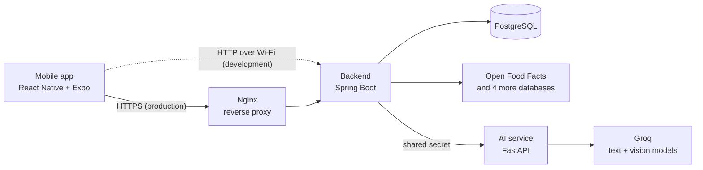

# Health Scan


**Know what you eat and use, in seconds.**

Health Scan is a mobile app that scans product barcodes and fruit photos and tells you how healthy they are. Scan food, cosmetics and other everyday products for a 0–100 health score with positives, negatives and ingredients, or photograph a fruit to check whether it is fresh or spoiled.

<!-- Demo video or screenshots -->

## Features

- **Barcode scanning** – every common format, including the square codes on newer packs (GS1 DataMatrix and GS1 Digital Link QR).
- **Health score** – calculated from Nutri-Score, NOVA and additives when Open Food Facts has them; an LLM writes the explanation. Other products get a clearly labelled AI estimate.
- **Unknown products** – if no database knows the barcode, the app searches the web, and then offers to read the ingredient label from a photo.
- **Fruit check** – a vision model rates a fruit as fresh, spoiled or uncertain, and says what the photo shows if it is not a fruit.
- **Recent scans**, Greek and English, light and dark theme.

## How it works



In production the phone reaches the backend only through Nginx over HTTPS; during development it talks to the backend directly on the local Wi-Fi.

1. The app reads the barcode and asks the backend.
2. The backend answers from its PostgreSQL cache, or looks the barcode up in five free product databases, cheapest first.
3. The score is calculated from the product's Nutri-Score grade (A 90, B 72, C 55, D 35, E 15), minus 10 for ultra-processed (NOVA 4) or 5 for processed (NOVA 3), minus 2 per additive up to 10.
4. The AI service asks an LLM on Groq to explain the score, and the result is cached so the next scan is instant.

The phone only talks to the backend, and only the AI service holds the Groq key.

## Tech stack

| Part | Stack |
|------|-------|
| Mobile | React Native 0.88, Expo SDK 58, TypeScript, AsyncStorage |
| Backend | Java 17, Spring Boot 3.3, Spring Data JPA, Flyway, Bucket4j |
| AI service | Python 3.11, FastAPI, Pydantic, Groq (`gpt-oss-20b`, `qwen3.8-27b` vision) |
| Data | PostgreSQL 16, Open Food / Beauty / Products Facts, UPCitemdb, USDA FoodData Central |
| Infrastructure | Docker Compose, Nginx + Certbot (HTTPS), GitHub Actions |

## Getting started

You need Docker, Node.js 22+, a free [Groq API key](https://console.groq.com/keys) and the Expo Go app on your phone.

```bash
cp .env.example .env                 # set GROQ_API_KEY, POSTGRES_PASSWORD and AI_SHARED_SECRET
cp mobile/.env.example mobile/.env   # set your computer's LAN IP
docker compose up -d --build         # PostgreSQL, AI service and backend on :8080
cd mobile && npm install && npm start
```

Scan the QR code with your phone (on the same Wi-Fi). `MOCK_AI=1` in `.env` runs everything without a Groq key, with canned AI answers.

For a public server, `docker compose --profile https up -d` puts Nginx in front of the backend, and Certbot gets and renews a Let's Encrypt certificate for `DOMAIN`; see `.env.example`.

| Variable | Required | Purpose |
|----------|----------|---------|
| `GROQ_API_KEY` | Yes | Groq key for the AI features |
| `POSTGRES_PASSWORD` | Yes | Database password |
| `AI_SHARED_SECRET` | Yes | Secret between backend and AI service (`openssl rand -hex 32`) |
| `API_KEY` | No | Requires `X-Api-Key` on the API; the app sends `EXPO_PUBLIC_API_KEY` |
| `EXPO_PUBLIC_API_BASE` | Yes, in `mobile/.env` | Backend URL the phone can reach |

## Security

- Input validation (`400`), an 8 MB upload limit (`413`), and per-IP rate limits with Bucket4j (`429` with `Retry-After`), stricter on the endpoints that call Groq.
- Optional API key. It ships inside the app, so it deters abuse; it is not user authentication.
- Only the backend is published. PostgreSQL and the AI service stay on the internal network, and the AI service requires a shared secret.
- Containers run as a non-root user, AI replies are validated before use, and errors are RFC 9457 problem JSON.
- HTTPS through Nginx with automatic Let's Encrypt certificates, HTTP to HTTPS redirect, HSTS and security headers.
- CI scans with CodeQL, Gitleaks and Trivy, and Dependabot keeps dependencies updated.

## Testing

| Suite | Tests | Tools |
|-------|-------|-------|
| Backend | 119 | JUnit 5, Mockito, MockMvc, Testcontainers (real PostgreSQL), JaCoCo 80% gate |
| AI service | 46 | pytest with a fake Groq client |
| Mobile | 61 | Jest, React Native Testing Library |
| End-to-end | 21 | Playwright: API security checks, and the app's screens run in a browser |

```bash
cd backend && mvn verify
cd ai-service && pip install -r requirements-dev.txt && python -m pytest
cd mobile && npm test && npm run typecheck
```

No unit test needs an API key or network access. GitHub Actions runs every suite, the end-to-end tests against the whole stack in mock mode, and the security scans on each push and pull request, then builds and publishes the Docker images.

## Project structure

```
backend/      Spring Boot API: lookup, scoring, caching, security
ai-service/   FastAPI service that talks to Groq
mobile/       Expo app
e2e/          Playwright end-to-end tests
nginx/        HTTPS reverse proxy and Certbot setup
```

## Acknowledgements

Product data from [Open Food Facts](https://world.openfoodfacts.org), [Open Beauty Facts](https://world.openbeautyfacts.org) and [Open Products Facts](https://world.openproductsfacts.org) under the [Open Database License](https://opendatacommons.org/licenses/odbl/1-0/), plus [UPCitemdb](https://www.upcitemdb.com) and [USDA FoodData Central](https://fdc.nal.usda.gov). Models served by [Groq](https://groq.com).
