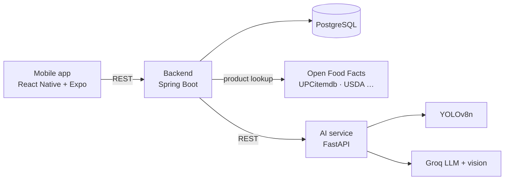

# Health Scan

A mobile app that scans food barcodes and fruit photos and tells you how healthy they are. Scan a product to get a 0–100 health score with its positives, negatives, ingredients and nutrition facts, or take a photo of a fruit to check whether it is fresh or spoiled.

## Features

- **Barcode scanning** – looks the product up in five free databases (Open Food Facts, Open Beauty Facts, Open Products Facts, UPCitemdb, USDA FoodData Central) and scores it with an LLM.
- **Unknown products** – if no database knows the barcode, photograph the ingredient label (read by a vision model) or search the web for it.
- **Fruit quality check** – YOLOv8 detects the fruit; a vision model rates it as fresh, spoiled or uncertain. Fruits YOLO doesn't know are identified by the vision model directly.
- **Caching** – every analyzed product is stored in PostgreSQL, so repeat scans are instant.
- **Greek and English**, light and dark theme.

## Architecture



| Component | Stack | Port |
|-----------|-------|------|
| `mobile/` | React Native, Expo SDK 58, TypeScript | 8085 (Metro) |
| `backend/` | Java 17, Spring Boot 3, Spring Data JPA, WebClient | 8080 |
| `ai-service/` | Python 3.11, FastAPI, Ultralytics YOLOv8, Groq API | 8000 |
| Database | PostgreSQL 16 | 5432 |

## Getting started

### Prerequisites

- [Docker](https://docs.docker.com/get-docker/) with Docker Compose
- [Node.js](https://nodejs.org/) 20+
- A free [Groq API key](https://console.groq.com/keys)
- The [Expo Go](https://expo.dev/go) app on your phone

### 1. Configure

```bash
cp .env.example .env              # then set GROQ_API_KEY
cp mobile/.env.example mobile/.env  # then set your computer's LAN IP
```

### 2. Start the backend services

```bash
docker compose up -d --build
```

This starts PostgreSQL, the AI service and the backend. Check that the AI service is up with `curl http://localhost:8000/health`.

### 3. Start the mobile app

```bash
cd mobile
npm install
cd ..
npm start
```

Scan the QR code with your phone's camera (iOS) or the Expo Go app (Android). The phone must be on the same Wi-Fi network as your computer.

## Configuration

| Variable | Where | Required | Description |
|----------|-------|----------|-------------|
| `GROQ_API_KEY` | `.env` | Yes | Groq API key used for scoring, label reading, fruit quality and web search |
| `USDA_API_KEY` | `.env` | No | USDA FoodData Central key; defaults to the rate-limited `DEMO_KEY` |
| `EXPO_PUBLIC_API_BASE` | `mobile/.env` | Yes | Backend URL reachable from the phone, e.g. `http://192.168.1.10:8080` |

## API

### Backend (`http://localhost:8080/api/v1`)

| Method | Path | Description |
|--------|------|-------------|
| `GET` | `/product/{barcode}?lang=en\|el` | Look up and score a product. Returns `found: false` if no database knows it |
| `POST` | `/product/{barcode}/label?lang=` | Identify a product from a label photo (`{"image": "<base64>"}`) |
| `POST` | `/product/{barcode}/web-search?lang=` | Search the web for the barcode (slow, ~10–30 s) |
| `POST` | `/analyze-image` | Fruit quality from a multipart image upload |
| `POST` | `/analyze-image-base64` | Fruit quality from `{"image": "<base64>"}` |

### AI service (`http://localhost:8000`)

| Method | Path | Description |
|--------|------|-------------|
| `POST` | `/analyze` | Health score, summary, pros/cons from name + ingredients |
| `POST` | `/analyze-image` | Fruit detection and quality |
| `POST` | `/read-label` | Extract product name and ingredients from a label photo |
| `POST` | `/search-product` | Find a product by barcode on the web |
| `GET` | `/health` | Health check |

## Project structure

```
.
├── docker-compose.yml
├── .env.example
├── ai-service/            # FastAPI: YOLO + Groq
│   ├── main.py
│   └── Dockerfile
├── backend/               # Spring Boot REST API
│   └── src/main/java/com/healthscan/backend/
│       ├── controller/
│       ├── service/       # product lookup chain, AI calls
│       ├── entity/
│       ├── repository/
│       └── dto/
└── mobile/                # Expo app
    ├── App.tsx
    └── src/
        ├── api/           # backend client
        ├── components/ui/ # glass card, buttons, score gauge, chips
        ├── context/       # theme and language
        ├── hooks/         # useProduct, useImageAnalysis, useCamera
        ├── screens/
        └── utils/
```

## Troubleshooting

- **Phone can't connect** – make sure `EXPO_PUBLIC_API_BASE` uses your computer's LAN IP (not `localhost`), the phone is on the same Wi-Fi, and Windows Firewall allows ports 8080 and 8085 on private networks.
- **No health score** – check `GROQ_API_KEY` in `.env`, then `docker compose up -d --build`.
- **Product not found** – use the label photo option; small or regional brands are often missing from public databases.
- **Containers not running** – `docker compose ps` and `docker compose logs backend`.
