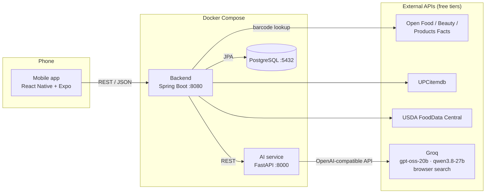
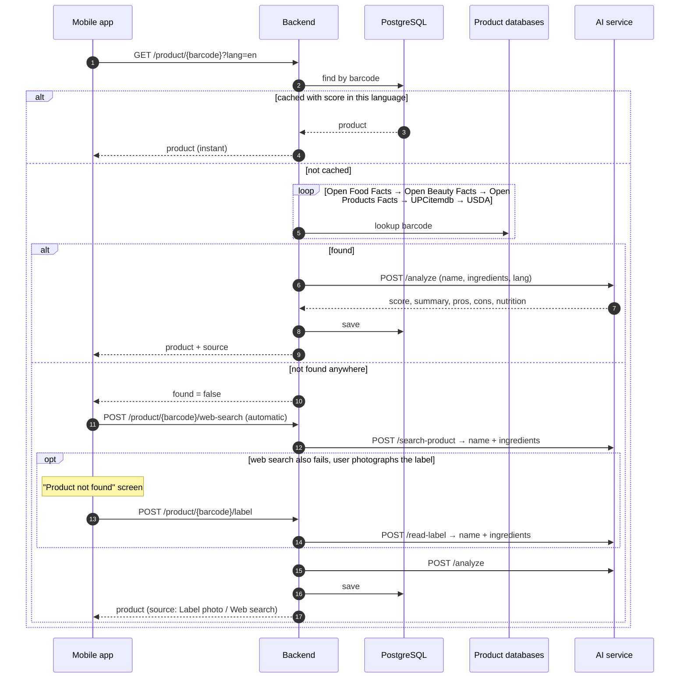
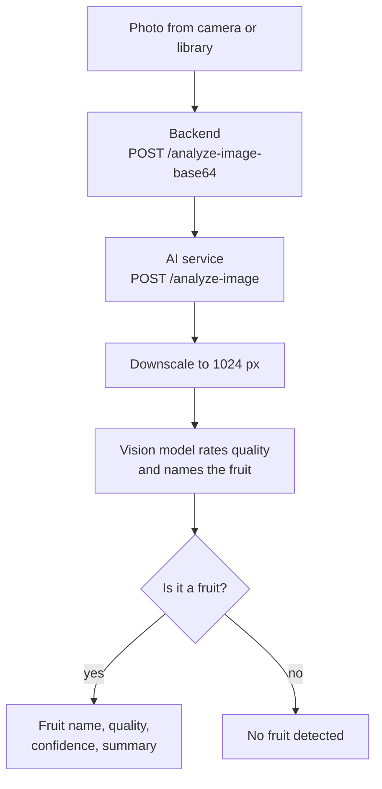
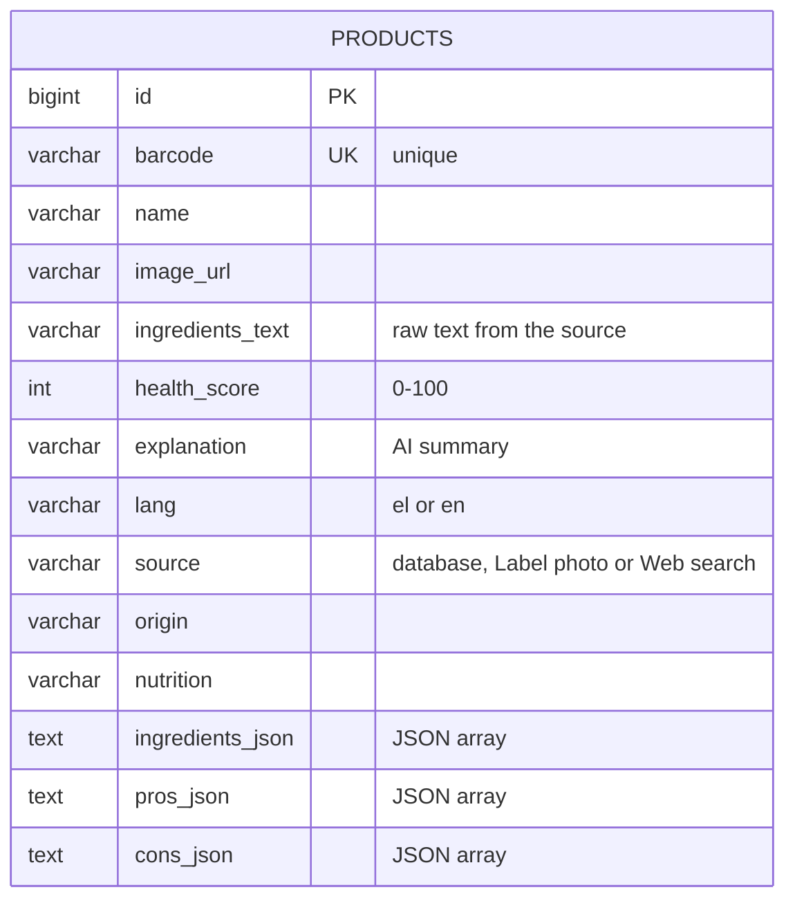
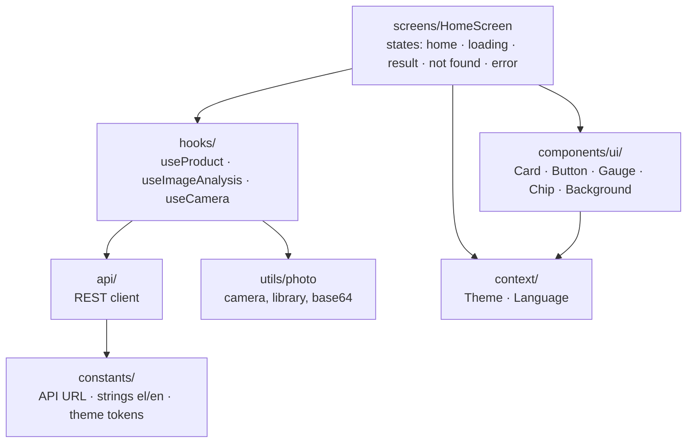

# Health Scan


**Know what you eat and use, in seconds.**

Health Scan is a mobile app that scans product barcodes and fruit photos and tells you how healthy they are. Scan food, cosmetics and other everyday products to get a 0–100 health score with positives, negatives, ingredients and nutrition facts, or take a photo of a fruit to check whether it is fresh or spoiled.

## Table of contents

- [Features](#features)
- [Architecture](#architecture)
  - [System overview](#system-overview)
  - [Components](#components)
  - [Barcode scan flow](#barcode-scan-flow)
  - [Fruit check flow](#fruit-check-flow)
  - [Data model and caching](#data-model-and-caching)
  - [Mobile app structure](#mobile-app-structure)
  - [Design decisions](#design-decisions)
- [Data sources](#data-sources)
- [Getting started](#getting-started)
- [Configuration](#configuration)
- [API reference](#api-reference)
- [Project structure](#project-structure)
- [Testing and CI/CD](#testing-and-cicd)
- [Troubleshooting](#troubleshooting)
- [Roadmap](#roadmap)
- [Acknowledgements](#acknowledgements)
- [License](#license)

## Features

- **Barcode scanning** – looks the product up in five free databases and scores it with an LLM: health score, summary, positives, negatives, ingredients, origin and nutrition facts.
- **Unknown products** – if no database knows the barcode, the app searches the web automatically, and the user can photograph the ingredient label (read by a vision model) if that fails too. The result is saved, so the next scan is instant.
- **Fruit quality check** – a vision model identifies any fruit in a photo and rates it as fresh, spoiled or uncertain. If the photo isn't a fruit, the app says what it shows instead.
- **Caching** – every analyzed product is stored in PostgreSQL per language.
- **Greek and English**, light and dark theme, glassmorphism UI.
- **Free to run** – every external service used has a free tier.

## Architecture

### System overview



The phone talks only to the backend. The backend owns the database and the product lookup, and delegates all machine learning to the AI service, which is the only component holding the Groq API key.

### Components

| Component | Stack | Responsibility |
|-----------|-------|----------------|
| **Mobile app** (`mobile/`) | React Native 0.88, Expo SDK 58, TypeScript | Barcode scanner, photo capture, results UI, language and theme |
| **Backend** (`backend/`) | Java 17, Spring Boot 3.3, Spring Data JPA, WebClient | REST API, product lookup chain, caching, orchestration of AI calls |
| **AI service** (`ai-service/`) | Python 3.11, FastAPI, OpenAI SDK → Groq | Health scoring, label reading, web search, fruit quality |
| **Database** | PostgreSQL 16 | Cache of analyzed products |

**Models**

| Task | Model | Where it runs |
|------|-------|---------------|
| Health score, summary, pros/cons | `openai/gpt-oss-20b` (low reasoning effort, JSON mode) | Groq |
| Web search for unknown barcodes | `openai/gpt-oss-20b` + built-in browser search | Groq |
| Label reading, fruit identification and quality | `qwen/qwen3.8-27b` (vision) | Groq |

### Barcode scan flow



### Fruit check flow



### Data model and caching



Caching rules:

- A product is served from the cache only if it has a score **and** was analyzed in the requested language; otherwise it is looked up and analyzed again.
- Barcodes that no source knows are **not** cached in `products`, so a later scan, label photo or web search can still fill them in.
- A failed web search is recorded in `web_search_misses` and not repeated for a day, which protects the Groq quota. AI outages are not recorded.
- Label photo and web search products are in no database, so a request in the other language re-analyzes them from the cached row.
- Concurrent scans of the same new barcode are safe: a duplicate insert is ignored and every request gets the analysis.
- The schema is managed by Hibernate (`ddl-auto=update`).

### Mobile app structure



- **Screens** render state; **hooks** own the state and side effects; **api** only does HTTP.
- **components/ui** is a small design system: frosted glass cards (`expo-blur`), gradient buttons, an SVG score ring and chips, all driven by theme tokens.
- All user-facing text lives in `constants/strings.ts` in Greek and English.

### Design decisions

- **Separate AI service.** Python suits ML and image work, while Java/Spring handles the API and persistence. Each side can be scaled or replaced independently, and only the AI service holds the Groq key.
- **One scoring path.** Label photos and web search only *identify* the product (name and ingredients); scoring always goes through the same `/analyze` endpoint, so results are consistent regardless of source.
- **Lookup chain, cheapest first.** Free open databases come first, rate-limited APIs next, then an automatic web search the user can skip. The app starts the search after the lookup returns, so the first response stays fast.
- **Vision model only for fruit.** An earlier version ran YOLOv8 first, but it only knew three fruits and saved no LLM calls, so it was removed. The user's square crop already centres the fruit.
- **Base64 JSON uploads.** Photos are sent as base64 in JSON, which avoids multipart quirks in React Native; the image picker provides the base64 directly.

## Data sources

| Source | Covers | Key | Limit |
|--------|--------|-----|-------|
| [Open Food Facts](https://world.openfoodfacts.org) | Food, worldwide | None | Generous |
| [Open Beauty Facts](https://world.openbeautyfacts.org) | Cosmetics | None | Generous |
| [Open Products Facts](https://world.openproductsfacts.org) | Other products | None | Generous |
| [UPCitemdb](https://www.upcitemdb.com/api/explorer) | General retail, names only | None (trial) | 100 lookups/day |
| [USDA FoodData Central](https://fdc.nal.usda.gov/api-guide) | US branded foods | Free key (or `DEMO_KEY`) | Low with `DEMO_KEY` |
| [Groq](https://console.groq.com) | LLM, vision, web search | Free key | Free-tier rate limits |

## Getting started

### Prerequisites

- [Docker](https://docs.docker.com/get-docker/) with Docker Compose
- [Node.js](https://nodejs.org/) 20+
- A free [Groq API key](https://console.groq.com/keys)
- The [Expo Go](https://expo.dev/go) app on your phone

### 1. Configure

```bash
cp .env.example .env                # set GROQ_API_KEY
cp mobile/.env.example mobile/.env  # set your computer's LAN IP
```

### 2. Start the backend services

```bash
docker compose up -d --build
```

This starts PostgreSQL, the AI service and the backend. Check that everything is up:

```bash
curl http://localhost:8000/health
curl "http://localhost:8080/api/v1/product/3017620422003?lang=en"
```

### 3. Start the mobile app

```bash
cd mobile && npm install && cd ..
npm start
```

Scan the QR code with your phone's camera (iOS) or the Expo Go app (Android). The phone must be on the same Wi-Fi network as your computer.

## Configuration

| Variable | File | Required | Description |
|----------|------|----------|-------------|
| `GROQ_API_KEY` | `.env` | Yes | Groq API key for scoring, label reading, fruit quality and web search |
| `USDA_API_KEY` | `.env` | No | USDA FoodData Central key; defaults to the rate-limited `DEMO_KEY` |
| `EXPO_PUBLIC_API_BASE` | `mobile/.env` | Yes | Backend URL reachable from the phone, e.g. `http://192.168.1.10:8080` |

## API reference

### Backend (`http://localhost:8080/api/v1`)

| Method | Path | Body | Description |
|--------|------|------|-------------|
| `GET` | `/product/{barcode}?lang=en\|el` | – | Look up and score a product. Returns `found: false` if no source knows it |
| `POST` | `/product/{barcode}/label?lang=` | `{"image": "<base64>"}` | Identify a product from a label photo |
| `POST` | `/product/{barcode}/web-search?lang=` | – | Search the web for the barcode (slow, ~10–30 s). The app calls this automatically; misses are remembered for a day |
| `POST` | `/analyze-image` | multipart `file` | Fruit identification and quality |
| `POST` | `/analyze-image-base64` | `{"image": "<base64>"}` | Fruit identification and quality |

<details>
<summary>Example product response</summary>

```json
{
  "barcode": "3017620422003",
  "name": "Nutella",
  "found": true,
  "source": "Open Food Facts",
  "healthScore": 15,
  "explanation": "High in sugar and palm oil, low nutritional value.",
  "origin": "Italy",
  "nutrition": "≈539 kcal, 31 g fat, 57 g carbs (56 g sugar), 5 g protein per 100 g",
  "ingredients": ["sugar", "palm oil", "hazelnuts", "cocoa", "skimmed milk powder"],
  "pros": ["Convenient spread", "Rich flavor"],
  "cons": ["Very high sugar content", "High in saturated fat"],
  "imageUrl": "https://images.openfoodfacts.org/..."
}
```

</details>

### AI service (`http://localhost:8000`)

| Method | Path | Description |
|--------|------|-------------|
| `POST` | `/analyze` | Health score, summary, pros/cons from name + ingredients |
| `POST` | `/analyze-image` | Fruit identification and quality |
| `POST` | `/read-label` | Extract product name and ingredients from a label photo |
| `POST` | `/search-product` | Find a product by barcode on the web |
| `GET` | `/health` | Health check |

Interactive docs are available at `http://localhost:8000/docs` (FastAPI Swagger UI).

## Project structure

```
.
├── docker-compose.yml
├── .env.example
├── ai-service/                # FastAPI + Groq
│   ├── main.py
│   ├── requirements.txt
│   └── Dockerfile
├── backend/                   # Spring Boot REST API
│   ├── pom.xml
│   ├── Dockerfile
│   └── src/main/java/com/healthscan/backend/
│       ├── controller/        # REST endpoints
│       ├── service/           # lookup chain, AI orchestration, image analysis
│       ├── entity/            # JPA entity
│       ├── repository/        # Spring Data repository
│       └── dto/               # request/response models
└── mobile/                    # Expo app
    ├── App.tsx
    ├── .env.example
    └── src/
        ├── api/               # backend client
        ├── components/ui/     # design system
        ├── constants/         # API URL, strings, theme
        ├── context/           # theme and language providers
        ├── hooks/             # useProduct, useImageAnalysis, useCamera
        ├── screens/           # HomeScreen
        └── utils/             # photo capture and encoding
```

## Testing and CI/CD

No test needs an API key or a network connection: the product databases, the AI service and Groq are all stubbed.

```bash
cd backend && mvn test                                                # JUnit, Mockito, MockMvc
cd ai-service && pip install -r requirements-dev.txt && python -m pytest
cd mobile && npm test && npm run typecheck                            # Jest, React Native Testing Library
```

[GitHub Actions](.github/workflows/ci.yml) runs all three suites and the type check on every push to `main` and on every pull request, then builds both Docker images. Pushes to the default branch also publish the images to GitHub Container Registry as `ghcr.io/<owner>/healthscan-backend` and `ghcr.io/<owner>/healthscan-ai-service`, tagged with the commit SHA and `latest`.

## Troubleshooting

| Problem | Fix |
|---------|-----|
| Phone can't connect | `EXPO_PUBLIC_API_BASE` must use your computer's LAN IP (not `localhost`); restart `npm start` after changing it; phone and computer on the same Wi-Fi; allow ports 8080 and 8085 in the firewall |
| No health score | Check `GROQ_API_KEY` in `.env`, then `docker compose up -d --build` |
| Product not found | The web search runs first; if it fails, use the label photo. Small or regional brands are often missing from public databases |
| Expo Go asks to sign in to Expo CLI | Run `npx expo login` (or set `EXPO_TOKEN`) with the same account as the phone |
| Containers not running | `docker compose ps` and `docker compose logs backend` |

## Roadmap

- [ ] Scan history and favorites on the device
- [ ] Category-specific scoring for cosmetics and non-food products
- [ ] Nutri-Score and NOVA group from Open Food Facts
- [ ] Contribute label-photo results back to Open Food Facts
- [ ] Deploy the published images to a hosted environment

## Acknowledgements

- Product data from [Open Food Facts](https://world.openfoodfacts.org), [Open Beauty Facts](https://world.openbeautyfacts.org) and [Open Products Facts](https://world.openproductsfacts.org), available under the [Open Database License](https://opendatacommons.org/licenses/odbl/1-0/).
- Additional data from [UPCitemdb](https://www.upcitemdb.com) and [USDA FoodData Central](https://fdc.nal.usda.gov).
- Language and vision models served by [Groq](https://groq.com).

## License

[MIT](LICENSE)
